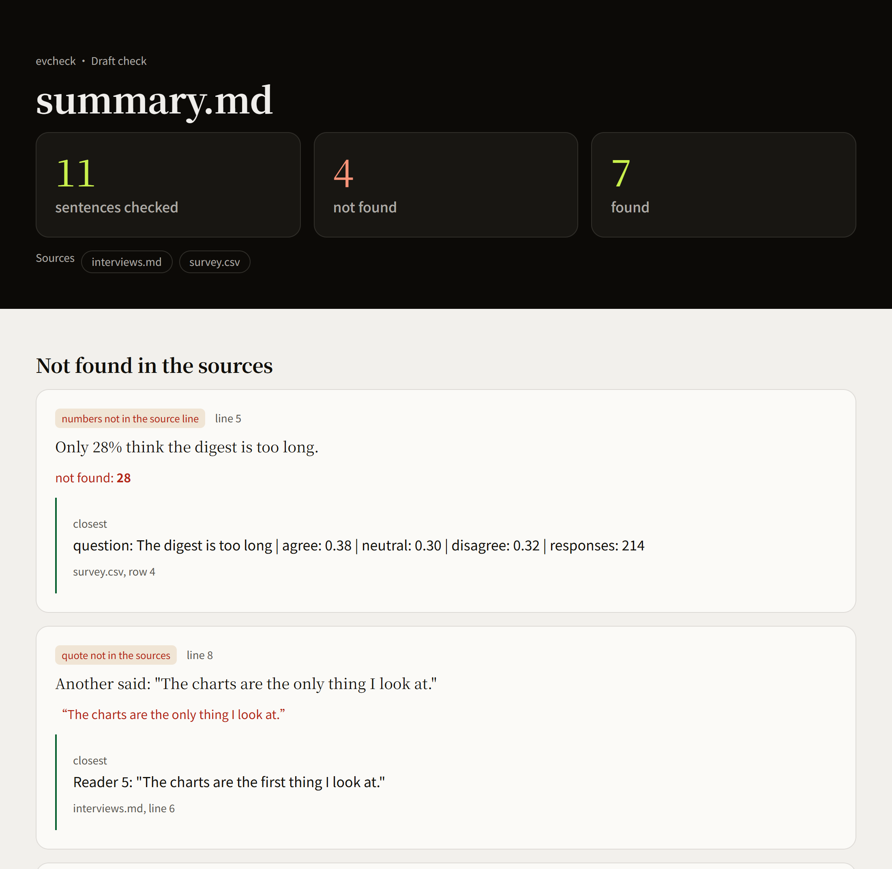

# evidence-check

Check that every number and quotation in a draft is really in your own files, before you send it.

- **evcheck**, a command-line tool and MCP server. Give it a finished draft and the folder it was written from; it lists every sentence whose number or quotation is not in those files, with the closest line. Offline, no model, no account.
- **An [Agent Skill](https://agentskills.io)** that makes an AI quote its source word for word for every fact it writes, and checks the quotes with the same rules.

[中文说明](README.zh-CN.md)

## Check a draft in one line

Install (Python 3.10 or later, with [uv](https://docs.astral.sh/uv/)):

```bash
uv tool install "evcheck[docs] @ git+https://github.com/llia0031-dotcom/evidence-check"
```

Run:

```bash
evcheck summary.md --sources data/
```

Result, for the example in [`eval/v5/sets/D`](eval/v5/sets/D) (11 sentences checked; two of the four problems shown):

```
 ✗  line 5  Only 28% think the digest is too long.
      numbers not in the source line
      not found: 28
      closest: survey.csv, row 4: question: The digest is too long | agree: 0.38 | neutral: 0.30 | disagree: 0.32 | responses: 214
 ✗  line 8  Another said: "The charts are the only thing I look at."
      quote not in the sources
      “The charts are the only thing I look at.”
      closest: interviews.md, line 6: Reader 5: "The charts are the first thing I look at."

11 sentences checked: 7 found in the sources, 4 not. 1 sentence without a number or quotation was not checked.
```

`--html report.html` writes the same result as a page to share:



- **Drafts:** Markdown, text, Word, PDF, web pages. **Sources:** files or folders of the same, plus CSV and Excel; each table row is read with its column names.
- **Exit code** 1 when a sentence is not found, 0 when all are, 2 when a file cannot be read, so it can stop a script or a CI step. `--json -` prints the full result, `--problems-only` hides the sentences that were found, `--lang zh` gives Chinese labels.
- **Without `[docs]`** it reads Markdown, text and CSV and needs nothing else (Python 3.9 or later): `pip install "evcheck @ git+https://github.com/llia0031-dotcom/evidence-check"`.
- **`--llm`, optional:** for each sentence not found, Claude Haiku 5.5 points at the passage that states it, in any language, and the script checks that passage like any other: a sentence passes only on a real passage that holds its numbers. The token count and cost are shown before anything is sent (four sentences of a Chinese draft against English sources: US$0.0004). Needs `evcheck[llm]` and `ANTHROPIC_API_KEY`.
- **How it works:** each sentence with a number, date, amount or quotation is matched to the closest lines of the sources by its words, then the Skill's script checks the quotes word for word and the numbers against those lines. A sentence that joins several facts is also searched part by part, and a month named in words (September, 9 月) picks that month's row of a table. It does not judge meaning, and a sentence without a number or quotation is not checked. Without `--llm`, the draft and the sources need to be in the same language.

## Let an AI assistant check its own writing (MCP)

```bash
claude mcp add evcheck -- uvx --from "evcheck[mcp] @ git+https://github.com/llia0031-dotcom/evidence-check" evcheck-mcp
```

The assistant gets three tools: `check_draft` for a whole draft, `check_claim` for one sentence and the quotes chosen for it, and `find_quote` for where a passage appears word for word (or the closest lines). When the files are in the assistant's own sandbox rather than on the machine running the server, it passes their text instead of their paths. Any MCP client can start the same command; it has been run in Claude Code and in DeerFlow.

## The Agent Skill

Answers and drafts written from documents go wrong in small, costly ways: a deadline moves by a day, a duration is worked out instead of copied, a detail appears that no document states. evidence-check has the agent quote its source for every fact, then runs a script that confirms:

1. **the quote is really in the cited file** (case, spacing, curly quotes and punctuation are forgiven);
2. **every date, time, amount and count in the claim is also in its quotes**, across English and Chinese: `下午2点` matches `14:00`, `五位` matches `Five`, `4.3万` matches `43,000`, `13:30` does not pass on a quote that says `13:00`.

The script cannot judge meaning: a real sentence can be cited for its opposite. So the skill also tells the agent to read every passing claim against its quotes.

### Two modes

- **Answer from documents.** "Answer only from handbook.md and faq.md, with a quote for every fact." Claims that fail the script are fixed or dropped before you see the answer.
- **Check a draft.** "Check this announcement against the rules folder." The agent splits the draft into claims, quotes a source for each, runs the script, and reports each problem with the document's own words and one suggested fix. It does not rewrite your draft.

### Install the Skill

Claude Code, as a plugin:

```
/plugin marketplace add llia0031-dotcom/evidence-check
/plugin install evidence-check@evidence-check
```

Any other agent that reads Agent Skills: copy `skills/evidence-check/` into its skills folder (for Claude Code without the plugin, `~/.claude/skills/evidence-check/`).

The script needs Python 3.9 or later and nothing else.

Version numbers: the agent's instructions (`SKILL.md`) are v0.2 and change only together with a new model evaluation; the script and the plugin are 0.5.0; evcheck is 0.6.0. Each is numbered on its own.

### Run the script yourself

A claims file lists each claim with the quotes that support it:

```json
{"claims": [
  {"id": "2", "text": "Projects must be submitted by 13:30 on Sunday.",
   "evidence": [{"source": "B02-update-notice-1.md",
                 "quote": "Project submission now closes on Sunday 17 January 2027 at 14:00 MYT instead of 13:00."}]}
]}
```

```bash
python skills/evidence-check/scripts/check_evidence.py claims.json --sources eval/v2/sources --format markdown
```

Output for four claims against the example documents in `eval/v2/sources`:

| # | Claim | Result | Evidence |
|---|---|---|---|
| 1 | Registration closes on 3 January 2027 at 23:59 MYT. | Supported | B01-build-weekend-handbook.md, line 35: "Registration opens on 1 December 2026 and closes on 3 January 2027 at 23:59 MYT, or earlier if all 120 places are taken." |
| 2 | Projects must be submitted by 13:30 on Sunday. | Numbers not in the quote (missing numbers: 13:30) | B02-update-notice-1.md, line 6: "Project submission now closes on Sunday 17 January 2027 at 14:00 MYT instead of 13:00." |
| 3 | 押金是50令吉。 | Supported | B01-build-weekend-handbook.md, line 35: "A place is confirmed only after a refundable deposit of RM 50 is paid." |
| 4 | Every participant gets a free T-shirt. | No evidence given | — |

Exit code 0 means every claim passed, 1 that at least one did not, 2 that the input could not be read. `--format json` gives the full report, `--lang zh` Chinese labels. Field reference and matching rules: [`references/claims-format.md`](skills/evidence-check/references/claims-format.md).

## What it catches

evcheck applies the script's rules, so its column is the script's, with one more limit at the end of the table.

| | Script | Agent's reading | Not handled |
|---|---|---|---|
| A quote that was edited, merged or invented | ✓ | | |
| A changed date, time, amount or count | ✓ | | |
| A number worked out instead of quoted ("two hours" for 19:00 to 20:30) | ✓ | | |
| A claim with no source | ✓ | | |
| A real sentence used for its opposite, a dropped condition, a wider scope | | ✓ | |
| A value replaced by a later document, when the old one is still among the sources | | ✓ in the v2 cases | |
| A number rounded to two significant digits or more (`0.31` for `0.314`): accepted and listed as rounded | ✓ | | |
| Sums, conversions and coarser rounding (`约 4 万` for `43,000`), Roman numerals: flagged for you to check | | | ✓ |
| evcheck only: a figure from the wrong row of a table, when the sentence does not name the row or other words fit several rows (in v6, 2 of 3 wrong-month figures were flagged) | | | ✓ |

## Used by

These projects, all by the same author, run the script on their own output:

- **[Grounded Review (ad-review agent)](https://github.com/llia0031-dotcom/grounded-review).** Its `check_quotes` tool runs the script on every quote from the ad and from the cited clause, so a quote that is not word for word in either is caught before anyone reads the answer.
- **[Grounded Labelling Pipeline](https://github.com/llia0031-dotcom/grounded-labelling-pipeline).** The review workflow built around Grounded Review: a decision whose quotes fail the check goes to the review queue, and every quote in its policy-library answers is checked against the clause it cites.
- **[Sellpoint Check](https://github.com/llia0031-dotcom/sellpoint-check).** Every quote it takes from product reviews is checked word for word against the review it came from.
- **[Evidence-backed resume screening](https://github.com/llia0031-dotcom/evidence-screening).** A frozen copy of script 0.2.0 checks the quotes behind each "meets the requirement" verdict, with the resume as the only source.
- **[Real-time voice agent evaluation](https://github.com/llia0031-dotcom/voice-agent-eval).** The dates, times and numbers in the agent's spoken confirmations are checked against the record of tool calls, with the script unchanged.
- **[Grounded Business Review](https://github.com/llia0031-dotcom/grounded-business-review).** Every passage of a weekly review that states a number must quote the rows of the query results it comes from and pass the script; a review that fails is not released.

## Related tools

- **[Citations](https://platform.claude.com/docs/en/build-with-claude/citations) in the Claude API** extracts each quote straight from your documents, so the quote is always really there. If you build on that API, use it. It cites the answer Claude is writing in the Messages API. It does not check a claim's numbers against its quote, it is not available to agents that read files through tools or to other models, and it does not split a draft someone already wrote into claims to check. evidence-check covers those.
- **Grounding checks in cloud platforms** (Vertex AI check grounding, Azure AI Content Safety groundedness detection, Amazon Bedrock Guardrails contextual grounding check) and **open checker models** (LettuceDetect, MiniCheck, HHEM) use a model to judge whether text is supported. evidence-check gives the exact quote and line for each claim and compares numbers without a model, a cloud account or extra packages.
- **Claim checkers that use a model or the web** (RefChecker, and MCP servers such as groundcheck or Factiverse) ask whether a sentence is true in general or supported according to a model. evcheck answers a narrower question, whether the number or quotation is in the files you gave it, and shows the line. **[andon](https://github.com/gulmezeren2-byte/andon)** checks figures in spreadsheets and reports against assertions you write; the two can be used together.
- **Evaluation frameworks** (RAGAS, DeepEval, TruLens, promptfoo) score a test set after the fact. This project's evaluation runs on promptfoo.

## Evaluation

All on fictional documents; the rounds with a model use Claude Haiku 5.5 and run each case twice:

- **v1, 84 pre-split sentences.** A plain prompt already got 167 of 168 judgements right; the script caught the one it missed, a duration worked out wrongly ("two hours" for 19:00 to 20:30).
- **v2, held out: 16 free answers and 8 unsplit drafts.** Every arm flagged all 30 planted errors. The only invented numbers were a calculated "32 hours" (4 of 32 plain answers, none with SKILL.md v0.2), and the script flags each one. Run afterwards on a plain prompt's output, the script also rejected 12 of 150 correct facts, because the quotes were incomplete; with the skill, the agent repairs its quotes and 2 to 3 false alarms remain. The skill costs about three times as much per task.
- **Script 0.3.0, from use in the projects above.** Nine matching rules for false alarms seen on their files (`December 2025`, `三分之一`, `4.3万`, `99.6%` against `0.996`, versioned model names). On 36 new cases fixed before the change, correct claims passed went from 3 of 16 to 16 of 16, and all 17 changed numbers are still flagged; no v1 or v2 result changed.
- **Script 0.4.0.** Rounding to at least two significant digits is accepted and listed in the report; Chinese ordinals near the quote, quoted group names, `a third`, times with seconds and names like `SigLIP 2` no longer raise false alarms. On 28 new cases fixed before the change, correct claims passed went from 0 of 11 to 11 of 11, and all 13 changed numbers or names are still flagged.

- **v5, evcheck on whole drafts.** On four drafts in Markdown and Word, with Markdown, CSV and Excel sources, it flagged all 16 planted errors and none of 25 correct sentences. In 32 writing tasks, an assistant that could call it stated no number outside the sources, against 6 without it; none of those 6 was a wrong figure (list numbers, counts, correctly worked-out growth rates), so what it adds here is that every number can be traced. On the assistants' answers it also raised 10 false alarms on sentences that join facts from different source lines, the next thing to fix. All 32 conversations cost US$0.0092 through the Batch API.
- **v6, evcheck 0.6.0.** Sentences that join several facts are searched part by part, and a month named in words picks its row. On 27 new cases fixed before the change, all 11 correct joined sentences pass and all 10 changed facts are still flagged; 2 of 3 wrong-month figures are flagged, against 0 before. On the 32 assistant answers of v5, false alarms fell from 10 to 2. An assistant using 0.6.0 kept more numbers (161 against 152) and still stated none outside the sources.

Full report: [`eval/EVALUATION.md`](eval/EVALUATION.md). The test documents and drafts are synthetic and were written by the same author as the skill.

## Develop

```bash
python -m unittest discover -s tests -v     # offline tests, no model calls
python eval/script_only.py                  # the script alone on the v1 cases
python eval/v2/score.py --check             # validate the v2 cases
python eval/v3/run.py                       # matching rules, script 0.2.0 against current
python eval/v4/run.py                       # rounding and name rules, script 0.3.0 against current
python eval/v5/run_cli.py                   # evcheck on the v5 drafts (Word and Excel need evcheck[docs])
python eval/v6/run.py                       # evcheck 0.5.0 against the current version on the v6 cases
```

The model comparisons use [promptfoo](https://www.promptfoo.dev) and need Node.js and an Anthropic API key in `eval/.env` (`ANTHROPIC_API_KEY=...`); the commands are at the top of each `promptfooconfig.yaml`. v5 part 2 runs with `python eval/v5/run_agents.py estimate | run | score` (needs `anthropic`).

## License

MIT. See [LICENSE](LICENSE).
